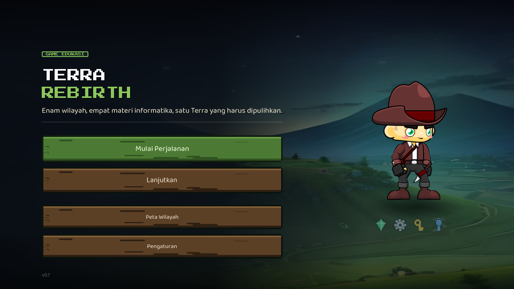
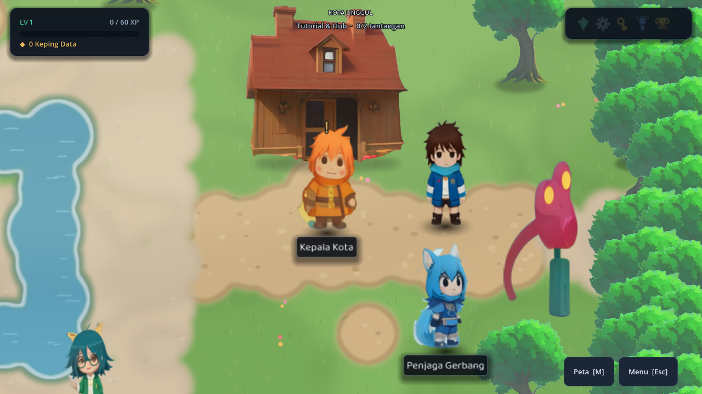
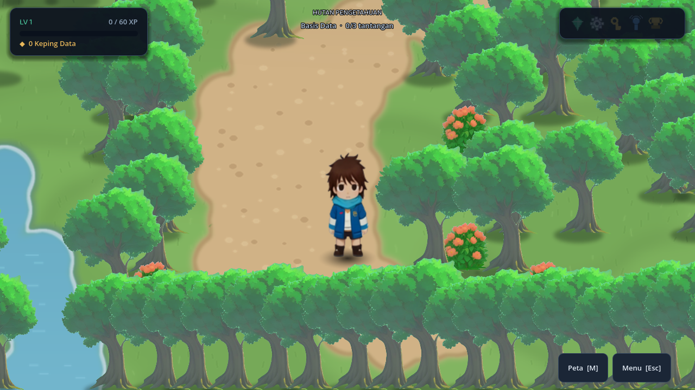
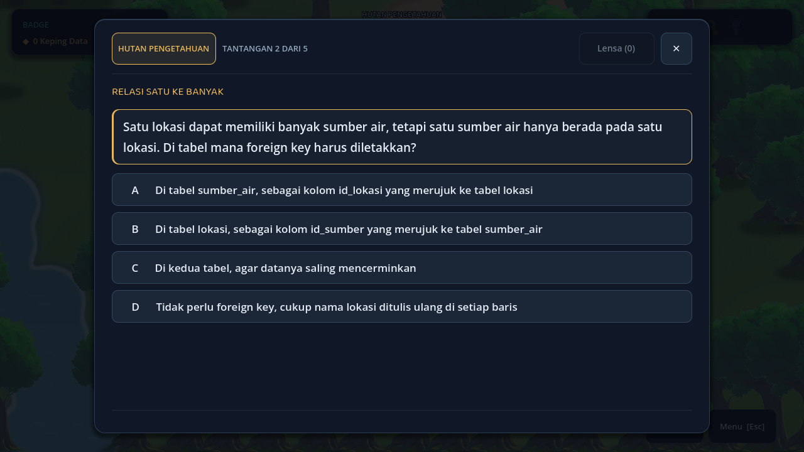
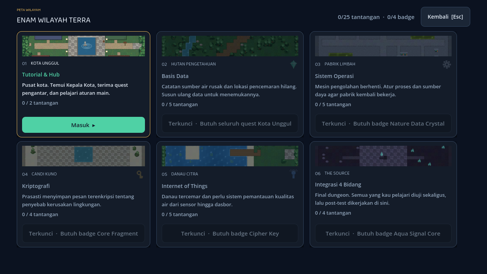
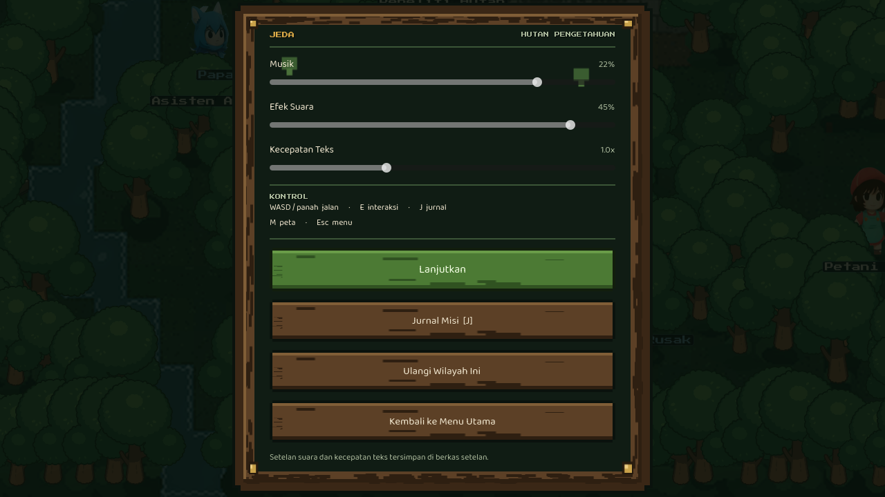
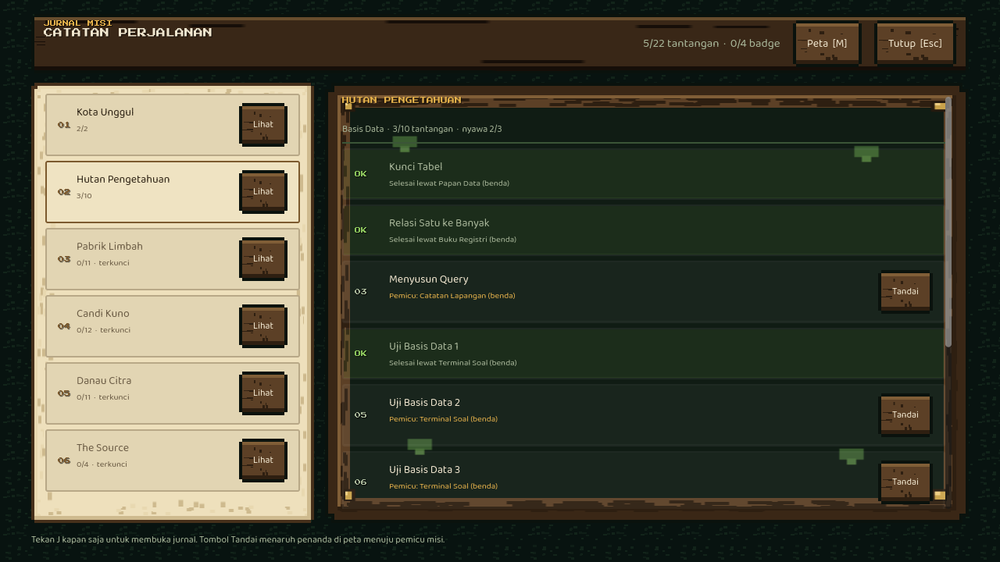
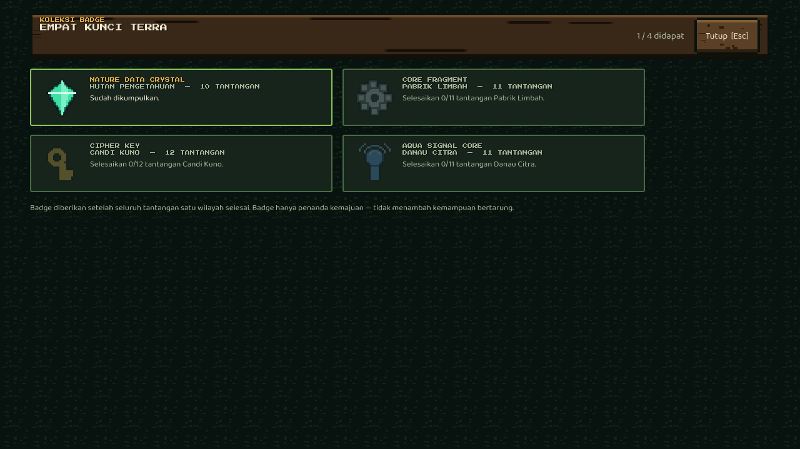
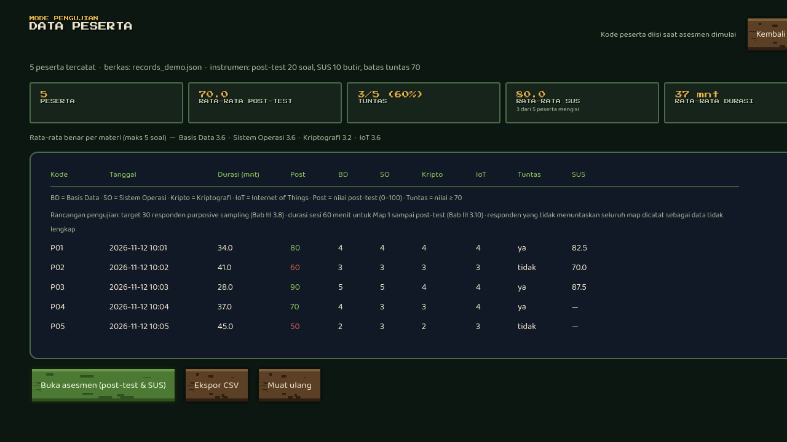

# Terra Rebirth — Game RPG Edukasi (Godot 4)

Permainan RPG edukasi untuk penelitian **"Pengembangan dan Evaluasi Game RPG Edukasi Terra Rebirth sebagai Media Pembelajaran Konsep Informatika"** (Kelompok 1, Program Studi Informatika).

Dibangun dengan **Godot 4.7 + GDScript**. Enam wilayah dapat dimainkan penuh dari layar judul sampai keputusan akhir (build v0.7). Seluruh aset dibuat khusus untuk proyek ini — tidak ada aset pihak ketiga berlisensi, sehingga aman untuk laporan.

## Main langsung di browser

**https://zefhanaa.github.io/terra-rebirth/**

Tidak perlu instalasi apa pun — cukup buka tautannya di Chrome/Firefox (desktop atau Android). Butuh internet saat pertama kali memuat (±48 MB).

Untuk mencoba versi terbaru dari kode sumber, lihat bagian [Cara menjalankan](#1-cara-menjalankan) di bawah.

## Tangkapan layar

| Layar judul                           | Kota Unggul (hub)                |
| ------------------------------------- | -------------------------------- |
|  |  |

| Eksplorasi Hutan                    | Tantangan puzzle                |
| ----------------------------------- | ------------------------------- |
|  |  |

| Peta wilayah                 | Layar jeda + pengaturan + kontrol |
| ---------------------------- | --------------------------------- |
|  |     |

| Jurnal misi                          | Koleksi badge                      |
| ------------------------------------ | ---------------------------------- |
|    |    |

| Mode Riset: rekap + ringkasan rata-rata |
| --------------------------------------- |
|       |

Demo versi terkini (57 detik, musik, jalan kaki tanpa teleport): [`dokumentasi/gameplay-terbaru.mp4`](dokumentasi/gameplay-terbaru.mp4)

Video demo 78 detik: [`dokumentasi/gameplay-tour.mp4`](dokumentasi/gameplay-tour.mp4)

**Permainan penuh 6 wilayah sampai penutup cerita (7 menit 25 detik):** [`dokumentasi/gameplay-lengkap-6map.mp4`](dokumentasi/gameplay-lengkap-6map.mp4)

---

## 1. Cara menjalankan

### A. Lewat build web (paling cepat, tanpa instalasi)

```bash
cd build/web
python3 -m http.server 8000
# buka http://localhost:8000
```

Di Windows: klik dua kali `jalankan-web.bat` (butuh Python terpasang).
Build web **tidak bisa** dibuka langsung dengan klik dua kali `index.html` (browser memblokir WebAssembly dari `file://`).

### B. Lewat Godot Editor

1. Pasang Godot 4.7 (https://godotengine.org/download).
2. `Import` → pilih `project.godot` pada folder ini → `Open`.
3. Tekan **F5**.

### C. Ekspor ulang

Preset Web sudah tersedia di `export_presets.cfg`:

```bash
godot --headless --path . --export-release "Web" build/web/index.html
```

### D. Video demo

`dokumentasi/gameplay-terbaru.mp4` — rekaman 57 detik dari build terkini: jalan kaki dari spawn kota → dialog Pedagang → toko → gerbang kota masih terkunci → quest kota selesai → gerbang terbuka → masuk Hutan Pengetahuan. Direkam dengan `TERRA_DEMO=terbaru` lewat `tools/rekam.sh`, musik disisipkan setelah perekaman (server rekam tanpa perangkat suara).

Merekam ulang:

```bash
Xvfb :99 -screen 0 1280x720x24 &
./tools/rekam.sh dokumentasi/gameplay-terbaru.mp4 48 terbaru
```

---

## 2. Kontrol

| Tombol            | Fungsi                                                       |
| ----------------- | ------------------------------------------------------------ |
| `W A S D` / panah | Berjalan                                                     |
| `E`               | Bicara dengan NPC, lanjut dialog, berinteraksi               |
| `J`               | Buka jurnal misi (daftar tantangan + tombol Tandai)          |
| `M`               | Buka peta wilayah                                            |
| `Esc`             | Layar jeda (pengaturan + kontrol), atau menutup panel        |
| Klik mouse        | Memilih jawaban, menyusun query, menggeser cakram sandi      |
| `Ctrl` + `R`      | Buka Mode Riset (rekap peserta) — untuk pengambilan data      |

Daftar tombol yang sama juga tertulis di layar jeda, jadi bisa dibuka kapan saja saat lupa.

---

## 3. Alur permainan

Permainan **tidak membuka dialog atau soal secara otomatis**. Pemain masuk ke peta, berjalan mencari NPC/objek, lalu menekan `E` untuk berinteraksi — sesuai Bab II 2.4 (eksplorasi → menemukan misi → tantangan → umpan balik → penguatan konsep → badge).

1. **Kota Unggul** (Map 1, hub & tutorial) — 4 NPC:
   - **Kepala Kota** (tanda `!`) memberi tugas dan membuka 2 tantangan pengantar.
   - **Penjaga Gerbang** menjelaskan badge yang harus dimiliki sebelum portal terbuka.
   - **Pedagang** menjual 5 barang: **Lensa Analisis** (20 uang, sekali pakai untuk membuka petunjuk) dan **4 komponen perangkat IoT** untuk Danau Citra (sensor pH air, papan rangkaian & kabel jumper, mikrokontroler ber-WiFi, sumber daya).
   - **Peneliti Lingkungan** memberi konteks cerita (danau tercemar).
     Map 1 **tidak memberi badge**; menyelesaikan kedua quest pengantar cukup untuk membuka Map 2.
2. **Hutan Pengetahuan** (Map 2, Basis Data) — 10 tantangan: 3 misi puzzle, 2 puzzle acak dari bank, dan **5 soal acak** dari bank Basis Data → **Badge Nature**.
3. **Pabrik Limbah** (Map 3, Sistem Operasi) — 11 tantangan: 4 misi puzzle, 2 puzzle acak, dan **5 soal acak** dari bank Sistem Operasi → **Badge Core**.
4. **Candi Kuno** (Map 4, Kriptografi) — 12 tantangan: 5 misi puzzle, 2 puzzle acak, dan **5 soal acak** dari bank Kriptografi → **Badge Cipher**.
5. **Danau Citra** (Map 5, Internet of Things) — 11 tantangan: 4 misi puzzle, 2 puzzle acak, dan **5 soal acak** dari bank IoT; komponen perangkat **dibeli di toko Kota Unggul** → **Badge Aqua**.
6. **The Source** (Map 6, final dungeon) — 4 ujian integrasi melawan **boss** (HP 4, berkurang tiap ujian lulus) → **post-test 20 soal + SUS 10 butir** → **keputusan akhir** pemain (segel sumber / susun ulang protokol) yang menentukan teks ending. Map 6 **tidak memberi badge**.

Total **50 tantangan** (Kota 2, Hutan 10, Pabrik 11, Candi 12, Danau 11, The Source 4) dan **4 badge**. Setiap misi diawali NPC mentor dan simulasi belajar, lalu memberi **10 uang** ketika selesai. Tidak ada level maupun XP: satu-satunya kunci akses adalah badge.

**Soal dan puzzle diundi, bukan dihafal.** Bank soal berisi **200 soal** (50 per materi) dan bank puzzle berisi **40 puzzle** (10 per materi; 20 tipe `order`, 20 tipe `fill`). Setiap kali wilayah dimuat, 5 soal dan 2 puzzle diambil acak dari bank, jadi pemain yang mengulang wilayah tidak menerima soal yang sama.

**Nyawa per wilayah.** Setiap wilayah punya **3 nyawa**. Jawaban kuis salah mengurangi 1 nyawa; puzzle yang gagal langsung menghabiskan sesi (fatal). Nyawa habis → wilayah itu **diulang dari awal**, tetapi **uang, barang yang sudah dibeli, komponen, dan badge tetap disimpan** — hukuman tidak pernah mengunci progres.

**Audio:** musik latar diputar per wilayah (`bgm_final` di The Source, `bgm_explore` di lima wilayah lain) plus efek klik/benar/salah/koin/badge/portal. Volume musik, volume efek suara, dan kecepatan teks diatur lewat **penggeser di layar jeda** (bisa juga dibuka dari layar judul lewat tombol **Pengaturan**); ujung kiri penggeser bertanda **Mati** dan benar-benar membisukan suara. Setelan disimpan di `user://settings_terra.json`, terpisah dari simpanan permainan. Berkas WAV disintesis oleh `tools/gen_audio.py` (tanpa aset pihak ketiga).

**Penunjuk arah (HUD):** panah kuning di tepi layar menunjuk objek/NPC terdekat yang belum selesai,
lengkap dengan nama dan jarak dalam meter (1 petak = 1 m). Panah hilang bila jarak < 3 petak atau saat
panel soal/dialog terbuka — jadi pemain tidak perlu menebak ke mana harus berjalan di peta 40×22.

**Jurnal misi (`J`):** enam wilayah di kolom kiri dengan progres dan badge, daftar tantangan di kolom kanan beserta **pemicu**-nya (nama benda atau NPC yang harus ditemui). Tombol **Tandai** memasang belah ketupat emas berdenyut di atas sasaran itu di peta, dan panah HUD ikut menunjuk ke sana sampai pemain mendekat.

**Koleksi badge:** angka badge di HUD (`0 / 4 ›`) bisa diklik dan membuka empat kartu berisi ikon, asal wilayah, jumlah tantangan, syarat, dan status didapat/belum.

**Layar jeda (`Esc`):** tiga penggeser setelan, daftar kontrol, tombol **Lanjutkan**, **Jurnal Misi**, **Ulangi Wilayah Ini** (mengulang wilayah tanpa menghapus uang/barang/badge), dan **Kembali ke Menu Utama**.

**Aturan gating (Bab II 2.5, Tabel 2.5):**

- Badge **hanya** diberikan setelah **seluruh** quest pada suatu map selesai, termasuk tantangan akhir — bukan setiap jawaban benar.
- Map berikutnya terbuka **hanya bila badge map sebelumnya sudah dimiliki**. Tidak ada syarat level.

**Enam tipe tantangan:**

- `mcq` — pilihan ganda konsep (tutorial, soal bank, dan final).
- `build` — menyusun query SQL lewat dropdown (SELECT / FROM / JOIN / WHERE / ORDER BY).
- `order` — menyusun urutan langkah (penjadwalan proses, alur data IoT).
- `fill` — mengisi bagian kosong (istilah atau potongan kode) lewat pilihan yang disediakan.
- `cipher` — memutar cakram Caesar untuk membaca pesan.
- `craft` — membeli 4 komponen di toko Kota Unggul lalu merakit perangkat IoT (Danau Citra).

---

## 4. Asesmen (instrumen penelitian)

Rancangan penelitian adalah **one-group posttest-only** (Bab III 3.1), sehingga **tidak ada pre-test**. Ringkasan kesesuaian prototipe dengan draf dokumen terbaru (butir per butir Bab I–III) ada di `DOKUMENTASI_PROTOTIPE.md` §11. Instrumen dibuka otomatis setelah pemain menuntaskan Map 6, atau lewat **Mode Riset → Buka asesmen**:

1. **Kode peserta** — diisi di awal (mis. `P01`); dipakai untuk mencocokkan data.
2. **Post-test** — **20 soal pilihan ganda** yang **diundi dari bank 200 soal** (5 soal tiap materi: Basis Data, Sistem Operasi, Kriptografi, IoT), satu halaman per butir. Undian disimpan per kode peserta, jadi soal tidak berubah saat sesi diulang. Nilai = benar/20 × 100, batas tuntas **70** (Bab III 3.11).
3. **SUS** — **10 pernyataan** skala 1–5 dengan pola ganjil/genap, skor 0–100, dibandingkan dengan acuan **68,0** (Hyzy dkk., 2022).
4. **Ringkasan** — nilai post-test, rincian benar per materi, skor SUS, dan status tuntas.

**Mode Riset** (buka dengan `Ctrl` + `R` dari layar judul atau layar Peta Wilayah; sengaja tidak dipasang sebagai tombol menu karena ini alat pengambilan data, bukan fitur pemain) menampilkan:

- **Ringkasan agregat** di atas tabel: jumlah peserta, rata-rata post-test, ketuntasan (n/N dan persen), rata-rata SUS (hanya dari peserta yang mengisi), rata-rata durasi, dan rata-rata benar per materi.
- **Rekap per peserta**: kode, tanggal, durasi bermain, nilai post-test, benar per materi, status tuntas, skor SUS.
- Tombol **Buka asesmen** dan **Ekspor CSV**.
- Catatan rancangan pengujian: **target 30 responden purposive sampling** (Bab III 3.8) dan **durasi sesi 60 menit** untuk Map 1 sampai post-test (Bab III 3.10).

Data disimpan di `user://records_terra.json` dan dapat diekspor ke CSV untuk diolah di Excel/SPSS.

---

## 5. Struktur folder

```
project.godot            konfigurasi proyek (1280x720, autoload Game)
scenes/Main.tscn         scene tunggal, seluruh UI dibangun dari skrip
data/content.gd          6 peta, 22 misi puzzle, konfigurasi bank soal, alur cerita, 10 butir SUS
data/question_bank.gd    200 soal (50 per materi) hasil generator tools/gen_bank.py
data/puzzle_bank.gd      40 puzzle acak (10 per materi: order & fill)
scripts/game_state.gd    autoload: badge, progres, nyawa, simpan/muat, setelan, penilaian post-test & SUS, rekap
scripts/main.gd          orkestrator layar + input + transisi
scripts/player.gd        CharacterBody2D + AnimatedSprite2D 4 arah
scripts/world.gd         membangun peta (collision, 4 NPC, objek pencarian, portal, penanda tujuan)
scripts/portal.gd        gerbang antar wilayah (terkunci/terbuka)
scripts/ui/              ui_kit, hud, dialog_box, puzzle_panel, badge_popup, shop_panel, asesmen, pause_menu
scripts/screens/         title, map_select, research, journal, badges, ending
scripts/autotest.gd      uji integrasi otomatis (248 cek)
scripts/audit_konten.gd  audit isi konten: kunci jawaban, polaritas SUS, sandi, keterjangkauan peta, pemicu quest, toko & komponen (1512 cek)
tools/assets_gen.py      generator sprite, NPC, badge, panel, latar judul
tools/maps_gen.py        generator 6 peta (Kota 60x36, lainnya 40x22) + JSON collision
tools/gen_audio.py       sintesis WAV: 2 musik latar + 6 efek suara (tanpa aset pihak ketiga)
tools/shot.sh            pengambil tangkapan layar otomatis (Xvfb + ffmpeg)
assets/                  hasil generator: sprites, ui, maps, fonts, audio
dokumentasi/             tangkapan layar untuk laporan Bab III
build/web/               hasil ekspor web (siap disajikan lewat server lokal)
```

---

## 6. Uji otomatis

```bash
godot --headless --path . res://scenes/AutoTest.tscn        # alur permainan + asesmen + UI (248 cek)
godot --headless --script res://scripts/audit_konten.gd     # audit isi konten (1512 cek)
```

Menguji: eksplorasi objek → NPC mentor + simulasi → puzzle (build/order/fill/cipher/craft) → aturan badge (satu quest belum memberi badge) → gating antar-map → nyawa & pengulangan wilayah → uang & toko → boss → post-test & SUS (skor, rekaman, CSV) → ringkasan agregat Mode Riset → keputusan ending → simpan/muat & setelan → jurnal, penanda tujuan, koleksi badge, layar jeda → kasus batas (batal asesmen, post-test tanpa SUS, kode peserta ganda, durasi lintas sesi, quest tanpa pemicu).

Hasil terakhir: **248 cek, 0 gagal**; audit konten **1512 cek, 0 gagal**.

---

## 6b. Rekaman

- `dokumentasi/gameplay-lengkap-6map.mp4` — rekaman versi lama sebelum desain puzzle terbaru diterapkan.
- `dokumentasi/gameplay-kota.mp4` — satu wilayah: judul → hub → 2 quest → peta (52 dtk)
- `dokumentasi/gameplay-tour.mp4` — dua wilayah, termasuk objek dan tantangan di Hutan (78 dtk)
- `dokumentasi/gameplay-terbaru.mp4` — build terkini dengan musik: kota → toko → gerbang terkunci → gerbang terbuka → Hutan (57 dtk, tanpa teleport; gerakan jalan kaki)
- `dokumentasi/gameplay-toko-rakit.mp4` — potongan 22 dtk: toko Pedagang (4 komponen perangkat) → perakitan perangkat IoT di Danau Citra

Rekam ulang: `./tools/rekam.sh /tmp/out.mp4 445 full` (demo: `rekam`, `terbaru`, `tour`, `full`; untuk potret/dialog satu NPC: `TERRA_MAP=pabrik ./tools/shot.sh npc out.png 7 pabrik`).
Demo `full` memainkan seluruh permainan sendiri: berjalan ke NPC/objek, menyelesaikan misi puzzle, mengisi post-test dan SUS, lalu memilih keputusan akhir — berguna untuk merekam video tanpa operator.

Tangkapan layar statis bisa dibuat tanpa operator, misalnya:

```bash
TERRA_DEMO=pause TERRA_SHOT=/tmp/pause.png TERRA_SHOT_DELAY=3 godot --path .
# demo yang tersedia: title, pause, journal, mark, badges, settings, riset, research, ...
```

## 6c. Karakter

Sprite **96x136 per frame**, 4 arah × 3 frame, gaya chibi kartun halus (bukan pixel art):

- Sumber gambar: digambar khusus untuk proyek ini, lalu dirakit menjadi spritesheet 4 arah.
- `tools/icons48.py` — ikon objek 48×48 digambar vektor (supersample 4×) agar tetap tajam.
- Arah: depan, belakang, kanan, kiri (kiri = cermin dari kanan); 3 frame dengan geseran halus
  untuk kesan melangkah.
- Titik tumpu tetap di kaki, jadi collision (`22×12`) dan posisi di peta konsisten.

## 7. Aset

Seluruh aset peta, UI, karakter, dan properti dibuat khusus untuk proyek ini lewat skrip di `tools/` (bukan aset pihak ketiga, tidak ada lisensi yang dilanggar):

- `assets/sprites/mc/idle_00..09.png` + `run_00..09.png` — **karakter utama (MC) baru dari
  kelompok**: 10 frame idle + 10 frame run, dinormalkan ke kanvas 512×512 dengan kaki di dasar,
  lalu dipakai `scripts/player.gd` (animasi `idle`/`run`, `flip_h` untuk arah kiri).
  `assets/sprites/mc/portrait.png` dipakai layar judul dan potret dialog.
- `assets/sprites/hero.png` — sprite lama 96×136 (masih ada sebagai cadangan/arsip).
- `assets/sprites/props/sign_toko.png` — plang TOKO untuk kios Pedagang, teks dijaga tidak terbalik.
- `assets/sprites/npc_*.png` — kepala kota, peneliti, penjaga, pedagang (sel per 96×136).
- `assets/sprites/obj_sign.png`, `obj_part.png` — objek pencarian 48×48 (digambar vektor).
- `assets/ui/badge_*.png` — 4 ikon badge (Nature, Core, Cipher, Aqua).
- `assets/ui/title_bg.png`, `ending_bg.png` — ilustrasi latar layar judul dan penutup.
- `assets/maps/*.png` + `*.json` — 6 peta (Kota Unggul 60×36, lima lainnya 40×22 tile **48 px**), JSON memuat grid solid, spawn,
  posisi NPC, dan portal; `thumb_*.png` versi kecil untuk kartu peta wilayah.
  Digambar `tools/maps_gen.py` dengan gaya **datar 2D (tampak atas)**: bangunan hanya atap tanpa
  dinding/perspektif, bayangan kontak tipis. Setel `FLAT=0` untuk kembali ke gaya 3/4 lama.
- Tanah (rumput, jalan tanah, air, plaza batu) digambar prosedural: tepi organik, bercak halus,
  bayangan kontak — tanpa pola ubin yang terlihat berulang.
- Properti (gedung, pohon, semak, bunga) ditempel dengan urutan kedalaman (painter's algorithm).
- 16 properti industri/kuno baru (`assets/sprites/props/prop_*.png`: tangki, cerobong, mesin,
  konveyor, peti, pipa, pilar, relief, puing, rak server, terminal, pylon, aula pabrik, monolit inti)
  digambar prosedural dengan `tools/gen_props.py` (proyeksi isometrik, supersampling 3×) agar
  Pabrik Limbah, Candi Cipher, dan The Source tidak lagi berupa hamparan rumput kosong.
  Penataannya otomatis lewat `tools/place_props.py`: aset besar hanya di petak terlarang,
  aset kecil di tepi jalur, landmark di tengah gugusan, dan radius aman 2 petak dari NPC/objek/portal.
- Karakter, NPC, dan objek punya bayangan kontak (dibuat saat runtime di `world.gd`).
- `assets/fonts/Baloo2.ttf` — font UI membulat, lisensi SIL Open Font License 1.1.
- `assets/audio/*.wav` — musik latar dan efek suara disintesis programatik oleh
  `tools/gen_audio.py` (mono 22,05 kHz, gelombang segitiga + amplop); belum melewati Audacity.

Regenerasi aset: `./tools/regen.sh` (menjalankan kedua generator lalu memaksa Godot mengimpor ulang; butuh Pillow).
Gaya peta saat ini (datar 2D) dihasilkan `tools/maps_gen.py`; pipa gaya kartun lama (`mapmix.py`) tidak disertakan di repo ini.
Tanpa langkah impor ulang, Godot masih memakai tekstur lama di `.godot/imported/` — ini penyebab umum "aset sudah diubah tapi tidak berubah di layar".
